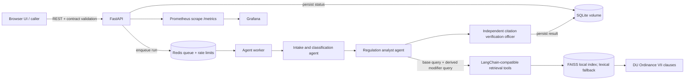

# System architecture

Deployment boundary: browser/API, agent worker, Redis, Prometheus, Grafana, and Jaeger are separate Compose services. SQLite and corpus/index files are local volumes. No student records, hosted model, paid API, or cloud service is required. The deterministic demo uses two distinct reasoning roles and four retrieval/field tools; no external generative model is wired into the current demonstrator.

## Multi-agent control flow

1. Intake validates via Pydantic at the API boundary, assigns the supported petition category, and extracts the petition ID through a tool.
2. Regulation analyst chooses retrieval queries. Attendance requests search the base rule and independently derive a second query for a modifying medical provision, deadlines, or cap.
3. Verification officer resolves every clause ID through exact clause lookup, checks the cited text against the source record, and applies conservative routing. Discretionary provisions always go to a human.
4. The graph terminates on a bounded three-node path. Worker failure returns a failed status and no confident recommendation.

The current local index is created from the checked-in clause dataset using a sentence-transformers model selected through local runtime configuration and FAISS when dependencies/model files are available. The fallback ranks token overlap deterministically. Chunks are clause-sized (no overlap), preserving clause identifiers and source metadata. `python -m app.ingest` rebuilds the index.
